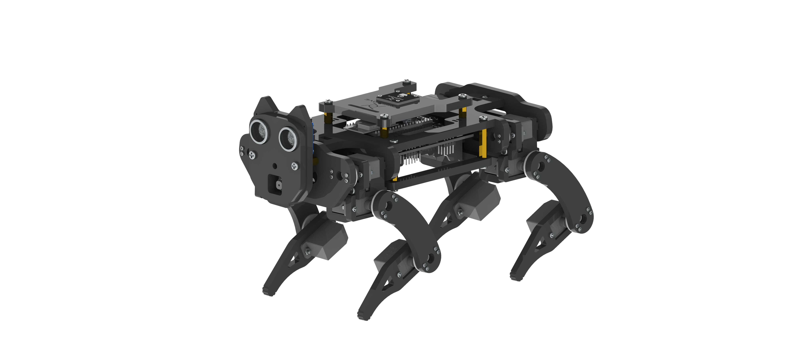
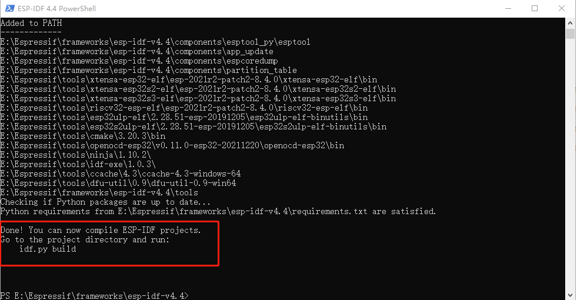
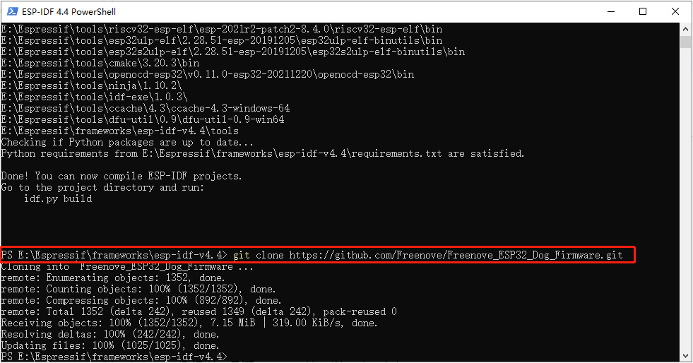
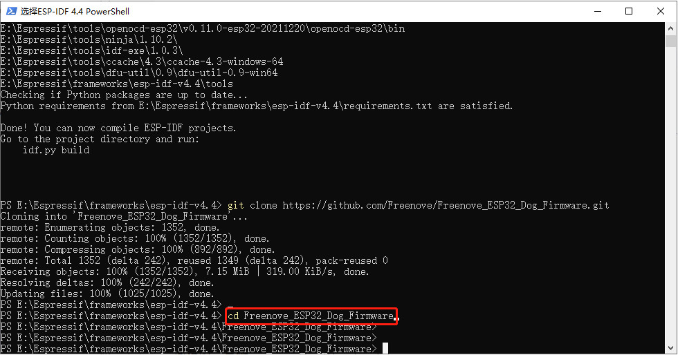
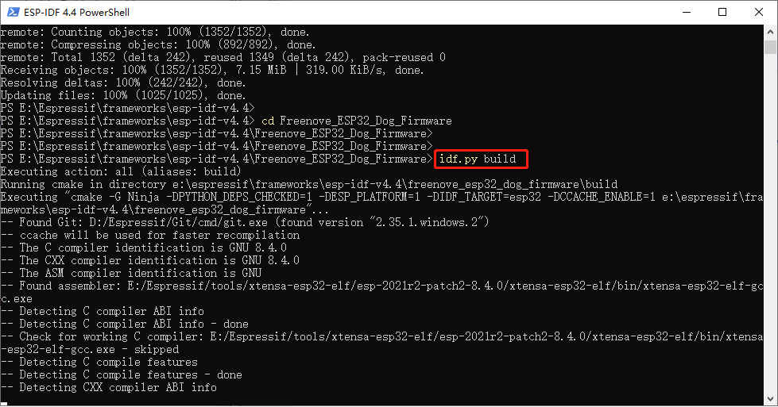
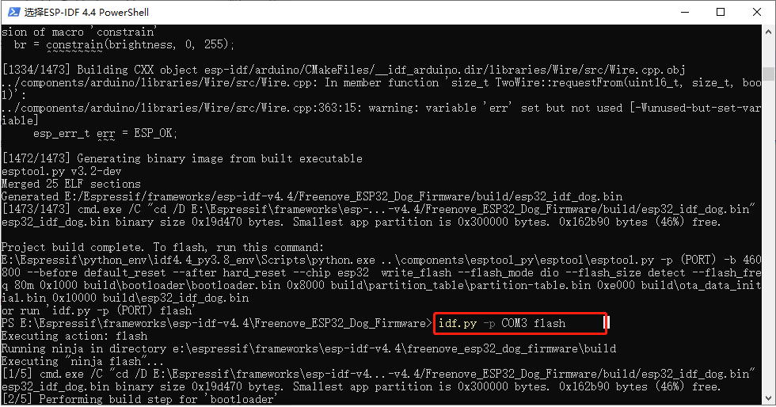
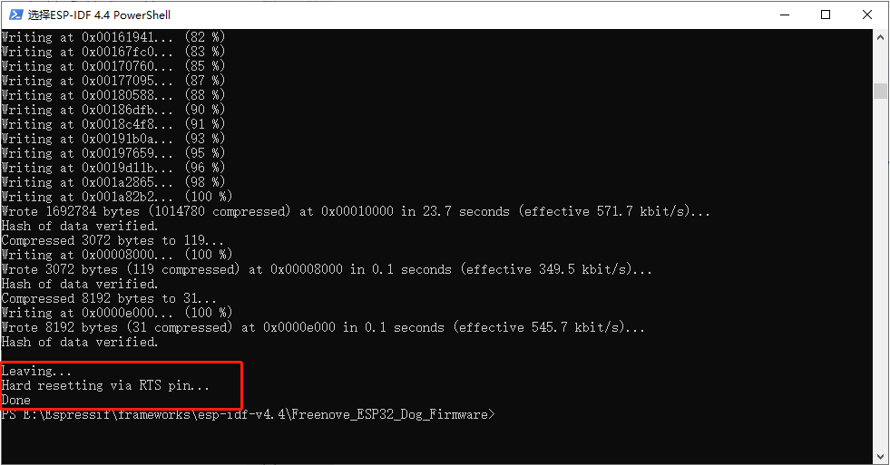

# Freenove_ESP32_Dog_Firmware
Firmware codes for Freenove product FNK0062.

> A Robot Dog Kit for ESP32.

**Language:** [English](Readme_EN.md) | [中文](Readme_CN.md)



## Description
This is the source code for Freenove_Robot_Dog_Kit_for_ESP32 (`Sketch_11_Dog`, ESP-IDF build).

For details about how to assemble and use Freenove_Robot_Dog_Kit_for_ESP32, see the following URL.

URL: [https://github.com/Freenove/Freenove_Robot_Dog_Kit_for_ESP32](https://github.com/Freenove/Freenove_Robot_Dog_Kit_for_ESP32)

### Download

* **Use command in console**

	Run following command to download all the files in this repository.

	`git clone https://github.com/Freenove/Freenove_ESP32_Dog_Firmware.git`

* **Manually download in browser**

	Click the green "Clone or download" button, then click "Download ZIP" button in the pop-up window.
	Do NOT click the "Open in Desktop" button, it will lead you to install Github software.

> If you meet any difficulties, please contact our support team for help.

## Usage
### Step 1. Install ESP-IDF.

Please refer to the official ESP-IDF programming guide to install a compilation environment suitable for your computer platform.

Recommended version for this project: **ESP-IDF v5.5.4**.

URL: [https://docs.espressif.com/projects/esp-idf/en/v5.5.4/esp32/get-started/index.html](https://docs.espressif.com/projects/esp-idf/en/v5.5.4/esp32/get-started/index.html)

### Step 2. Compile and download the project.
1, Set up the environment variables.

You can see the tip: 
> idf.py build



2, Download the code file.

>`git clone https://github.com/Freenove/Freenove_ESP32_Dog_Firmware.git`



3, Go to the code file directory

>`cd Freenove_ESP32_Dog_Firmware`



4, Set the chip target (first time / after cleaning).

>`idf.py set-target esp32`

5, Compile.

>`idf.py build`



6, Upload the bin to your Dog.

Different computer systems may have different download commands.  

Make sure you have ESP32 connected to your computer and that your computer has the CH340 driver installed.  

Windows: `idf.py -p COMx flash`

MAC OS: `idf.py -p /dev/cu.usbserial-xxxxx flash`

Ubuntu: `idf.py -p /dev/ttyUSB0 flash`



7, Finish



## Support

Freenove provides free and quick customer support. Including but not limited to:

* Quality problems of products
* Using Problems of products
* Questions of learning and creation
* Opinions and suggestions
* Ideas and thoughts

Please send an email to:

[support@freenove.com](mailto:support@freenove.com)

We will reply to you within one working day.

## Purchase

Please visit the following page to purchase our products:

http://store.freenove.com

Business customers please contact us through the following email address:

[sale@freenove.com](mailto:sale@freenove.com)

## Copyright

All the files in this repository are released under [Creative Commons Attribution-NonCommercial-ShareAlike 3.0 Unported License](http://creativecommons.org/licenses/by-nc-sa/3.0/).


This means you can use them on your own derived works, in part or completely. But NOT for the purpose of commercial use.
You can find a copy of the license in this repository.

Freenove brand and logo are copyright of Freenove Creative Technology Co., Ltd. Can't be used without formal permission.


## About

Freenove is an open-source electronics platform.

Freenove is committed to helping customer quickly realize the creative idea and product prototypes, making it easy to get started for enthusiasts of programing and electronics and launching innovative open source products.

Our services include:

* Robot kits
* Learning kits for Arduino, Raspberry Pi, ESP32, and micro:bit
* Electronic components and modules, tools
* Product customization service

Our code and circuit are open source. You can obtain the details and the latest information through visiting the following web site:

http://www.freenove.com

---

## 1. Development Environment & Dependencies

### Board

- **Board**: `ESP32-WROVER` (PSRAM required; camera and frame buffers depend on PSRAM)
- **Target**: `esp32` (see `sdkconfig` → `CONFIG_IDF_TARGET="esp32"`)

### ESP-IDF + Arduino as component

| Item | Version / Notes |
|------|-----------------|
| Build system | **ESP-IDF v5.5.4** (`idf.py` / VS Code ESP-IDF extension / Cursor) |
| Arduino-ESP32 (component) | **3.3.12** — declared in `main/idf_component.yml` |
| esp32-camera (component) | **^2.0.13** — declared in `main/idf_component.yml` |
| Pattern | `app_main` → `initArduino()` → `setup()` / `loop()` / `serialEventRun()` |

Managed components are pulled automatically on first configure/build (`managed_components/`).

### Bundled with this project (no extra Arduino Library Manager install)

| Component | Files | Description |
|-----------|-------|-------------|
| Freenove PCA9685 | `main/Freenove_PCA9685.h/.cpp` | 16-channel PWM servo driver (I2C) |
| Freenove WS2812 Lib for ESP32 | `main/Freenove_WS2812_Lib_for_ESP32.h/.cpp` | WS2812 RMT driver (compiled into `main`) |

### Built into Arduino-ESP32 / IDF (with the SDK)

`Wire`, `WiFi`, `Preferences`, `EEPROM`, `esp_camera`, FreeRTOS, BLE (`BLEDevice` API), etc. — no separate install needed.

### Suggested build notes

- Enable **PSRAM** in `sdkconfig` (WROVER)
- Bluetooth is enabled in `sdkconfig` (`CONFIG_BT_ENABLED`)
- Flash size / partition table: use the project’s existing `sdkconfig` (or menuconfig) unless you know you need a different layout

### Compared with Sketch_10_Dog

| | Sketch_10_Dog | Sketch_11_Dog |
|--|---------------|---------------|
| Build | Arduino IDE | ESP-IDF + Arduino component |
| Entry | `Sketch_10_Dog.ino` | `app_main.cpp` + `Sketch_11_Dog.cpp` |
| WS2812 lib | External Arduino library | Bundled under `main/` |
| BLE source API | NimBLE-Arduino | Arduino `BLEDevice` headers |

---

## 2. File Overview

Paths below are under `main/` unless noted.

### Entry & common layer

| File | Role |
|------|------|
| `app_main.cpp` | ESP-IDF entry: `initArduino()`, then call Arduino `setup` / `loop` / `serialEventRun` |
| `Sketch_11_Dog.cpp` | Program logic entry: `setup` / `loop` / `loopSecondary`; Serial / BLE / WiFi RX; message enqueue and special stop handling |
| `Public.h` / `Public.cpp` | Shared headers and global objects (queues, task handles, PCA9685, Preferences, etc.) |
| `RobotDefinitions.h` / `.cpp` | Hardware pins, body height, software version, robot name, and other constants |
| `BluetoothOrders.h` | Protocol command characters (`A`–`W` action codes) |
| `CMakeLists.txt` | `idf_component_register` sources / includes / requires |
| `idf_component.yml` | Component dependencies (arduino-esp32, esp32-camera) |

### Communication & protocol

| File | Role |
|------|------|
| `BluetoothService.h` / `.cpp` | BLE GATT service via Arduino `BLEDevice` API: advertising, TX/RX, stand up / lie down on connect / disconnect |
| `CameraService.h` / `.cpp` | WiFi (AP/STA), camera, command port (5000) and stream port (8000); auto-detect OV2640 / OV3660 / GC0308; sensors without JPEG use RGB565 + `frame2jpg` |
| `MessageParser.h` / `.cpp` | Parses `cmd#param#...\n` text into a command character and parameter array |
| `MassageQueue.h` / `.cpp` | Ring queue template `DataQueue<T>` (motion / info / TX / buzzer) |

### Task scheduling

| File | Role |
|------|------|
| `TaskManager.h` / `.cpp` | Create / suspend / resume FreeRTOS tasks |
| `TaskCommandService.h` / `.cpp` | Non-motion commands: ID check, RGB, buzzer, voltage, NVS, network, camera settings, etc. |
| `TaskMotionService.h` / `.cpp` | Motion commands: install pose, calibration, stand/sit, body height, twist, omnidirectional walk, dance |

### Motion & mechanics

| File | Role |
|------|------|
| `Motion.h` / `.cpp` | Inverse kinematics (coords → servo angles), standing, omnidirectional gait, twist, height control |
| `DanceMovements.h` / `.cpp` | Preset moves: say hello, push-up, stretch, turn around, sit down, dance, etc. |
| `Freenove_PCA9685.h` / `.cpp` | PCA9685 I2C PWM driving 12 leg servos |

### Peripheral drivers

| File | Role |
|------|------|
| `BatteryPower.h` / `.cpp` | Battery ADC sampling, voltage monitoring and reporting |
| `Buzzer.h` / `.cpp` | Buzzer PWM and melody queue playback |
| `NoteFrequency.h` | Note frequency table |
| `UltrasonicRanging.h` / `.cpp` | HC-SR04 ranging and auto-walk obstacle avoidance |
| `RGBLED_WS2812.h` / `.cpp` | On-board 4× WS2812 effect modes (uses bundled Freenove_WS2812_Lib_for_ESP32) |
| `BuiltInLed.h` / `.cpp` | On-board LED (GPIO2) status indicator |
| `TouchPad.h` / `.cpp` | Touch pad detection and response |

### Storage

| File | Role |
|------|------|
| `PreferencesPro.h` / `.cpp` | NVS wrapper: persistent servo offsets, LED config, etc. |

---

## 3. Robot Dog Logic

### 3.1 Overall data flow

```
Phone App / Serial / WiFi client
        │
        ▼
  RX callbacks (assemble lines by '\n')
  · onBleReceived
  · onWiFiCmdReceived
  · serialEventRun
        │
        ▼
  enterMessageQueue(msg)
        │
        ├─ Motion cmds (A/B/E/F/J/L/O…) ──► mqMotion ──► task_MotionService
        │                                              │
        │                                              ▼
        │                                         MessageParser
        │                                              │
        │                                              ▼
        │                                    Motion / Dance / PCA9685
        │                                              │
        │                                              ▼
        │                                           12 servos
        │
        └─ Other cmds (C/D/G/H/I/K/N/R/W…) ─► mqInfo ──► task_CommandService
                                                       │
                                                       ├─ RGB / buzzer / voltage / NVS
                                                       ├─ Camera / WiFi network
                                                       └─ Status TX ──► mqTx ──► BLE notify
```

### 3.2 Startup & task structure

`app_main()` calls `initArduino()`, then `setup()`.

`setup()` initializes in order: Serial → BLE → NVS → PCA9685 (release servos) → load servo offsets / LED config → camera / WiFi → ADC → buzzer → ultrasonic → RGB → on-board LED → touch, then:

1. Start the **motion task** `TASK_MOTION_SERVICE` (Core 1)
2. Start the **secondary loop** `TASK_SECONDRAY` / `loopSecondary` (Core 1)
3. Play power-up melody; warn if the camera failed; finally `standUp()`

Main loop `loop()` (driven by `app_main`’s while-loop, Arduino default Core 1) periodically runs:

- `task_CommandService`: consume `mqInfo`
- `task_BleUploadService`: send `mqTx` over BLE
- `task_showBuiltInLed`
- `flushPendingMotionStop`: enqueue the real stop only when the motion queue is empty
- Optional heap / PSRAM stats (code present in `loop()`, **commented out** by default)

`loopSecondary()` periodically runs:

- Battery monitor, RGB effects, auto-walk, buzzer service, touch detection

Camera work is placed on **Core 0** by `CameraService` when needed, separate from motion control to reduce stalls.

### 3.3 Command routing

| Cmd | Meaning | Queue |
|-----|---------|-------|
| `A` | Stand up / lie down | Motion |
| `B` | Body height | Motion |
| `C` | RGB LEDs | Info |
| `D` | Buzzer | Info |
| `E` | Twist pose | Motion |
| `F` | Omnidirectional move (incl. stop) | Motion (stop has special handling) |
| `G` | Camera | Info |
| `H` | Ultrasonic | Info |
| `I` | Read voltage | Info |
| `J` | Leg calibration | Motion |
| `K` | NVS read/write/clear | Info |
| `L` | Installation pose | Motion |
| `M` | Auto-walk enable | Info-side logic + ultrasonic task |
| `N` | Network (AP/STA) | Info |
| `O` | Dance | Motion |
| `R` | Set move speed, etc. | Info |
| `W` | ID / version / controller check | Info |

**Stop-command optimization**: `F#0#0#0#...` is not pushed into the motion queue immediately. It sets `motionStopPending` and is enqueued only after `mqMotion` is empty, so “stop” is always the last motion action and is not overwritten by older gait commands.

When the motion queue is full, the oldest message is dropped (lower latency). The info queue uses `enterForced` so important control / query messages are less likely to be lost.

### 3.4 Motion execution chain

```
Dequeue mqMotion
    → MessageParser
    → TaskMotionService branches by command
        → Motion: IK + gait interpolation / DanceMovements presets
            → Update each leg’s target angles (with NVS servo offsets)
                → Freenove_PCA9685 write PWM
                    → Servos move
```

### 3.5 Sensing & helpers

- **Ultrasonic**: ranging; with auto-walk enabled, stop / turn when something is too close ahead (`task_AutoWalking`)
- **Battery**: ADC voltage sampling, low-battery indication; mutex protects shared GPIO with ultrasonic when needed
- **Touch**: triggers feedback or actions
- **BLE connect / disconnect**: auto stand up / lie down and play the matching melody

### 3.6 Module dependency sketch

```
              app_main.cpp → Sketch_11_Dog.cpp
                            │
                     ┌──────┴──────┐
                     ▼             ▼
              BluetoothService  CameraService(WiFi+Cam)
                     │             │
                     └──────┬──────┘
                            ▼
                   enterMessageQueue
                     /          \
              mqMotion         mqInfo
                 │               │
        TaskMotionService  TaskCommandService
                 │               │
           Motion/Dance     RGB/Buzzer/NVS/...
                 │
            PCA9685 ──► servos
```

---

## 4. Camera models & image orientation

The firmware auto-detects the sensor PID in `CameraService::configureDetectedSensor()` and applies default horizontal mirror / vertical flip. If the preview looks upside-down or mirrored wrong, change `set_hmirror` / `set_vflip` there (`1` = on, `0` = off).

### Supported sensors and default orientation

| Sensor | PID | H-mirror `set_hmirror` | V-flip `set_vflip` | Pixel format |
|--------|-----|------------------------|--------------------|--------------|
| **OV2640** | `0x26` | `1` (on) | `1` (on) | Hardware JPEG preferred |
| **OV3660** | `0x3660` | `1` (on) | `0` (off) | Hardware JPEG preferred |
| **GC0308** | `0x9b` | `0` (off) | `0` (off) | No hardware JPEG → RGB565, then `frame2jpg` before streaming |
| Unknown | — | `1` (on) | `0` (off) | Chosen by driver capability |

### How to adjust orientation

1. Open `main/CameraService.cpp` and find `configureDetectedSensor()`.
2. Confirm the model from Serial: `Camera sensor PID: 0x...` / `Detected OVxxxx`.
3. Edit the matching branch:
   - **Left-right mirrored**: change `s->set_hmirror(s, 0/1);`
   - **Upside-down**: change `s->set_vflip(s, 0/1);`
4. Rebuild and flash.

Example (OV2640 upside-down — set `set_vflip` from `1` to `0`):

```cpp
if (pid == OV2640_PID)
{
    s->set_hmirror(s, 1);  // horizontal mirror: 1=on, 0=off
    s->set_vflip(s, 0);    // vertical flip: 1=on, 0=off
}
```

The same function also sets brightness / saturation / AE level (`set_brightness`, `set_saturation`, `set_ae_level`); tweak those if the image looks too dark or oversaturated.
