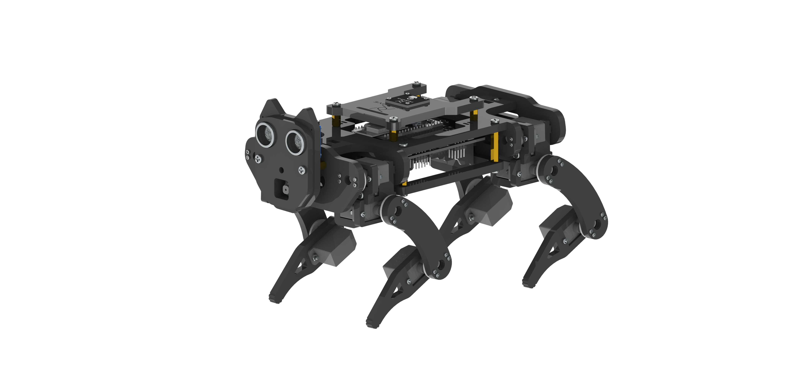
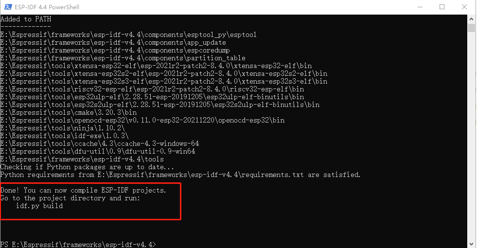
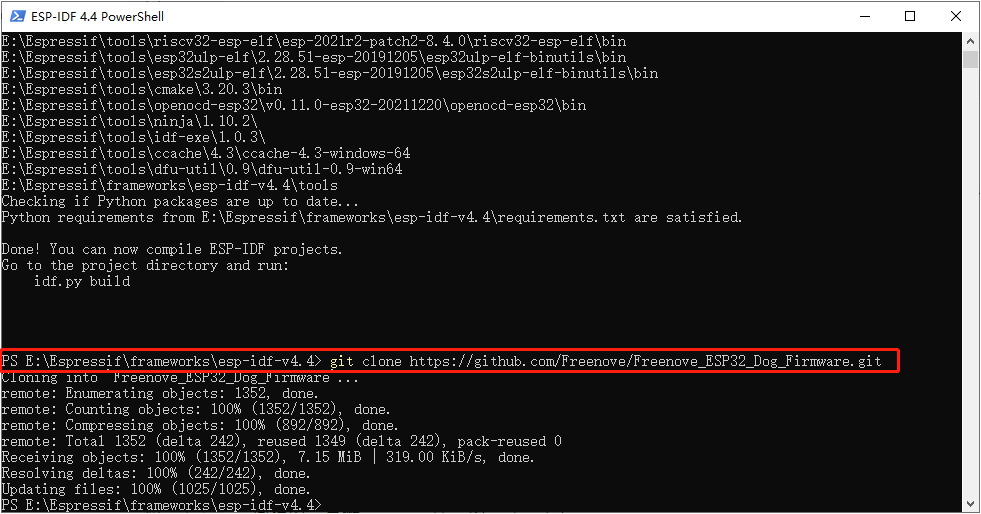
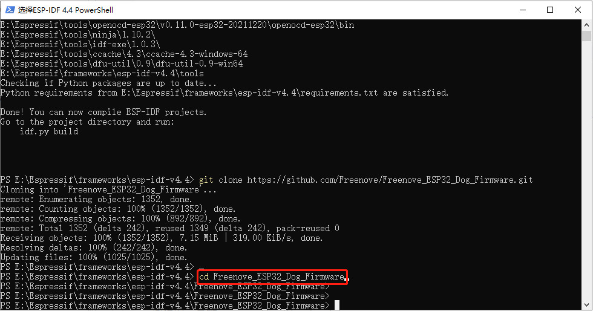
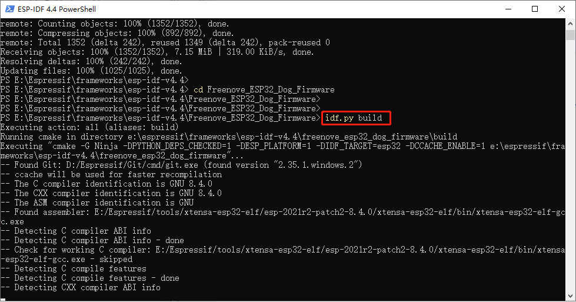
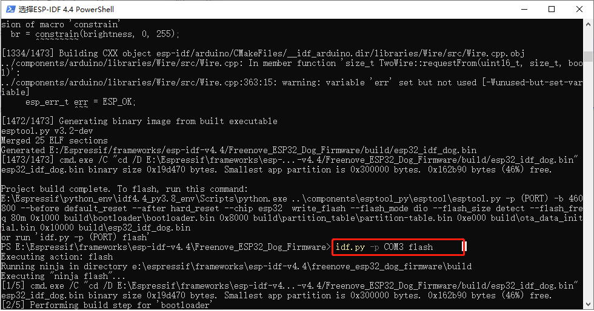
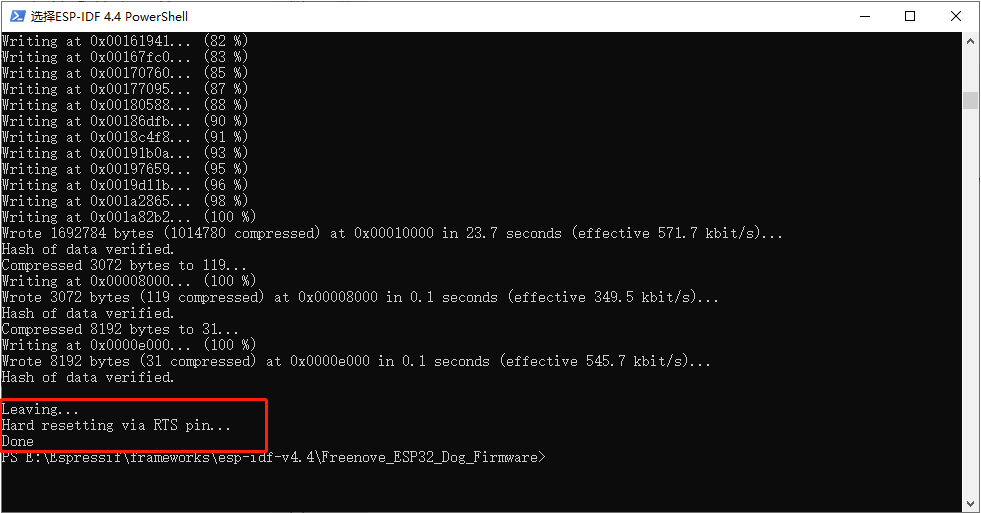

# Freenove_ESP32_Dog_Firmware
Freenove 产品 FNK0062 固件源码。

> ESP32 机器狗套件。

**语言 / Language:** [中文](Readme_CN.md) | [English](Readme_EN.md)



## Description
本目录为 Freenove_Robot_Dog_Kit_for_ESP32 的源码（`Sketch_11_Dog`，ESP-IDF 工程）。

关于 Freenove_Robot_Dog_Kit_for_ESP32 的组装与使用说明，请参见以下网址。

URL: [https://github.com/Freenove/Freenove_Robot_Dog_Kit_for_ESP32](https://github.com/Freenove/Freenove_Robot_Dog_Kit_for_ESP32)

### Download

* **使用控制台命令**

	运行以下命令下载本仓库的全部文件。

	`git clone https://github.com/Freenove/Freenove_Robot_Dog_Kit_for_ESP32.git`

* **在浏览器中手动下载**

	点击绿色的 "Clone or download" 按钮，然后在弹出窗口中点击 "Download ZIP" 按钮。
	请不要点击 "Open in Desktop" 按钮，那会引导你安装 Github 软件。

> 如遇到困难，请联系我们的技术支持团队寻求帮助。

## Usage
### Step 1. 安装 ESP-IDF。

请参考官方 ESP-IDF 编程指南，安装适合你电脑平台的编译环境。

本工程推荐版本：**ESP-IDF v5.5.4**。

URL: [https://docs.espressif.com/projects/esp-idf/en/v5.5.4/esp32/get-started/index.html](https://docs.espressif.com/projects/esp-idf/en/v5.5.4/esp32/get-started/index.html)

### Step 2. 编译并下载工程。
1, 配置环境变量。

可以看到提示： 
> idf.py build



2, 下载代码。

>`git clone https://github.com/Freenove/Freenove_Robot_Dog_Kit_for_ESP32.git`



3, 进入代码目录

>`cd Freenove_Robot_Dog_Kit_for_ESP32/Sketches/Sketch_11_Dog`



4, 设置芯片目标（首次或清理后）。

>`idf.py set-target esp32`

5, 编译。

>`idf.py build`



6, 将固件烧录到机器狗。

不同操作系统的烧录命令可能不同。  

请确认 ESP32 已连接电脑，并已安装 CH340 驱动。  

Windows: `idf.py -p COMx flash`

MAC OS: `idf.py -p /dev/cu.usbserial-xxxxx flash`

Ubuntu: `idf.py -p /dev/ttyUSB0 flash`



7, 完成



## Support

Freenove 提供免费且快速的客户支持，包括但不限于：

* 产品质量问题
* 产品使用问题
* 学习与创作相关问题
* 意见与建议
* 想法与思路

请发送邮件至：

[support@freenove.com](mailto:support@freenove.com)

我们将在一个工作日内回复。

## Purchase

请访问以下页面购买我们的产品：

http://store.freenove.com

企业客户请通过以下邮箱联系我们：

[sale@freenove.com](mailto:sale@freenove.com)

## Copyright

本仓库中的所有文件均以 [Creative Commons Attribution-NonCommercial-ShareAlike 3.0 Unported License](http://creativecommons.org/licenses/by-nc-sa/3.0/) 发布。


这意味着你可以在自己的衍生作品中部分或全部使用它们，但不得用于商业目的。
你可以在本仓库中找到该许可证的副本。

Freenove 品牌与标志为 Freenove Creative Technology Co., Ltd. 版权所有，未经正式许可不得使用。


## About

Freenove 是一个开源电子平台。

Freenove 致力于帮助客户快速实现创意与产品原型，让编程与电子爱好者更容易上手，并推出创新的开源产品。

我们的服务包括：

* 机器人套件
* Arduino、Raspberry Pi、ESP32、micro:bit 学习套件
* 电子元件、模块与工具
* 产品定制服务

我们的代码与电路均为开源。你可通过访问以下网站获取详情与最新信息：

http://www.freenove.com

---

## 1. 开发环境与依赖

### 板型

- **开发板**：`ESP32-WROVER`（需带 PSRAM，摄像头与图像缓冲依赖 PSRAM）
- **芯片目标**：`esp32`（见 `sdkconfig` → `CONFIG_IDF_TARGET="esp32"`）

### ESP-IDF + Arduino as component

| 项目 | 版本 / 说明 |
|------|-------------|
| 构建系统 | **ESP-IDF v5.5.4**（`idf.py` / VS Code ESP-IDF 插件 / Cursor） |
| Arduino-ESP32（组件） | **3.3.12** — 声明于 `main/idf_component.yml` |
| esp32-camera（组件） | **^2.0.13** — 声明于 `main/idf_component.yml` |
| 运行方式 | `app_main` → `initArduino()` → `setup()` / `loop()` / `serialEventRun()` |

首次配置/编译时会自动拉取 managed components（目录 `managed_components/`）。

### 工程自带（无需再装 Arduino 库管理器）

| 组件 | 文件 | 说明 |
|------|------|------|
| Freenove PCA9685 | `main/Freenove_PCA9685.h/.cpp` | 16 路 PWM 舵机驱动（I2C） |
| Freenove WS2812 Lib for ESP32 | `main/Freenove_WS2812_Lib_for_ESP32.h/.cpp` | WS2812 RMT 驱动（编进 `main` 组件） |

### Arduino-ESP32 / IDF 自带

`Wire`、`WiFi`、`Preferences`、`EEPROM`、`esp_camera`、FreeRTOS、BLE（`BLEDevice` API）等，无需单独安装。

### 建议编译注意

- 在 `sdkconfig` 中开启 **PSRAM**（WROVER）
- Bluetooth 已在 `sdkconfig` 中启用（`CONFIG_BT_ENABLED`）
- Flash / 分区表：优先沿用本工程现有 `sdkconfig`（或 menuconfig），除非你明确需要改布局

### 与 Sketch_10_Dog 的差异

| | Sketch_10_Dog | Sketch_11_Dog |
|--|---------------|---------------|
| 构建 | Arduino IDE | ESP-IDF + Arduino 组件 |
| 入口 | `Sketch_10_Dog.ino` | `app_main.cpp` + `Sketch_11_Dog.cpp` |
| WS2812 库 | 外部 Arduino 库 | 内置于 `main/` |
| BLE 源码 API | NimBLE-Arduino | Arduino `BLEDevice` 头文件 |

---

## 2. 文件说明

下列路径默认在 `main/` 下。

### 入口与公共层

| 文件 | 作用 |
|------|------|
| `app_main.cpp` | ESP-IDF 入口：`initArduino()`，再调用 Arduino 的 `setup` / `loop` / `serialEventRun` |
| `Sketch_11_Dog.cpp` | 业务入口：`setup` / `loop` / `loopSecondary`；串口 / BLE / WiFi 收包；消息入队与停止指令特殊处理 |
| `Public.h` / `Public.cpp` | 公共头文件与全局对象声明（队列、任务句柄、PCA9685、Preferences 等） |
| `RobotDefinitions.h` / `.cpp` | 硬件引脚、机身高度、软件版本、机器人名称等常量 |
| `BluetoothOrders.h` | 通信协议命令字定义（`A`~`W` 等动作码） |
| `CMakeLists.txt` | `idf_component_register` 源文件 / 头路径 / 依赖 |
| `idf_component.yml` | 组件依赖（arduino-esp32、esp32-camera） |

### 通信与协议

| 文件 | 作用 |
|------|------|
| `BluetoothService.h` / `.cpp` | 基于 Arduino `BLEDevice` API 的 BLE GATT：广播、收发、连接/断开时起立/趴下 |
| `CameraService.h` / `.cpp` | WiFi（AP/STA）、摄像头、命令口（5000）与图传口（8000）；自动识别 OV2640 / OV3660 / GC0308；无硬件 JPEG 时先采 RGB565 再 `frame2jpg` |
| `MessageParser.h` / `.cpp` | 将 `命令#参数#...\n` 文本解析为命令字与参数数组 |
| `MassageQueue.h` / `.cpp` | 环形消息队列模板 `DataQueue<T>`（运动 / 信息 / 发送 / 蜂鸣器） |

### 任务调度

| 文件 | 作用 |
|------|------|
| `TaskManager.h` / `.cpp` | 创建 / 挂起 / 恢复 FreeRTOS 任务 |
| `TaskCommandService.h` / `.cpp` | 非运动命令服务：ID 校验、RGB、蜂鸣器、电压、NVS、网络、摄像头参数等 |
| `TaskMotionService.h` / `.cpp` | 运动命令服务：安装位、校准、起立趴下、身高、扭转、任意方向走、舞蹈 |

### 运动与机械

| 文件 | 作用 |
|------|------|
| `Motion.h` / `.cpp` | 逆解（坐标→舵机角）、站立、任意方向步态、扭转、身高调节 |
| `DanceMovements.h` / `.cpp` | 打招呼、俯卧撑、伸懒腰、转身、坐下、跳舞等预设动作 |
| `Freenove_PCA9685.h` / `.cpp` | PCA9685 I2C PWM，驱动 12 路腿部舵机 |

### 外设驱动

| 文件 | 作用 |
|------|------|
| `BatteryPower.h` / `.cpp` | 电池 ADC 采样、电压监测与上报 |
| `Buzzer.h` / `.cpp` | 蜂鸣器 PWM 与旋律队列播放 |
| `NoteFrequency.h` | 音符频率表 |
| `UltrasonicRanging.h` / `.cpp` | HC-SR04 测距与自动行走避障逻辑 |
| `RGBLED_WS2812.h` / `.cpp` | 板载 4 颗 WS2812 灯效（依赖工程内 Freenove_WS2812_Lib_for_ESP32） |
| `BuiltInLed.h` / `.cpp` | 板载 LED（GPIO2）状态指示 |
| `TouchPad.h` / `.cpp` | 触摸按键检测与响应 |

### 存储

| 文件 | 作用 |
|------|------|
| `PreferencesPro.h` / `.cpp` | NVS 封装：舵机偏置、LED 配置等持久化读写 |

---

## 3. 机器狗逻辑关系

### 3.1 总体数据流

```
手机 App / 串口 / WiFi 客户端
        │
        ▼
  收包回调（按行 '\n' 组包）
  · onBleReceived
  · onWiFiCmdReceived
  · serialEventRun
        │
        ▼
  enterMessageQueue(msg)
        │
        ├─ 运动类命令（A/B/E/F/J/L/O…）──► mqMotion ──► task_MotionService
        │                                              │
        │                                              ▼
        │                                         MessageParser
        │                                              │
        │                                              ▼
        │                                    Motion / Dance / PCA9685
        │                                              │
        │                                              ▼
        │                                           12 路舵机
        │
        └─ 其它命令（C/D/G/H/I/K/N/R/W…）─► mqInfo ──► task_CommandService
                                                       │
                                                       ├─ RGB / 蜂鸣器 / 电压 / NVS
                                                       ├─ 摄像头 / WiFi 网络
                                                       └─ 状态回传 ──► mqTx ──► BLE notify
```

### 3.2 启动与任务结构

`app_main()` 先 `initArduino()`，再调用 `setup()`。

`setup()` 依次初始化：串口 → BLE → NVS → PCA9685（释放舵机）→ 读舵机偏置/LED 配置 → 摄像头/WiFi → ADC → 蜂鸣器 → 超声波 → RGB → 板载灯 → 触摸，然后：

1. 启动 **运动任务** `TASK_MOTION_SERVICE`（Core 1）
2. 启动 **副循环任务** `TASK_SECONDRAY` / `loopSecondary`（Core 1）
3. 播放开机旋律；若摄像头异常则提示；最后 `standUp()` 起立

主循环 `loop()`（由 `app_main` 的 while 驱动，Arduino 默认 Core 1）周期执行：

- `task_CommandService`：消费 `mqInfo`
- `task_BleUploadService`：把 `mqTx` 通过 BLE 发出
- `task_showBuiltInLed`
- `flushPendingMotionStop`：队列空闲时再真正入队停止指令
- 可选的堆 / PSRAM 统计（`loop()` 内有代码，**默认已注释**）

`loopSecondary()` 周期执行：

- 电池监听、RGB 灯效、自动行走、蜂鸣器服务、触摸检测

摄像头任务由 `CameraService` 在需要时挂到 **Core 0**，与运动控制分离，减轻卡顿。

### 3.3 命令分流要点

| 命令字 | 含义 | 队列 |
|--------|------|------|
| `A` | 起立 / 趴下 | 运动 |
| `B` | 机身高度 | 运动 |
| `C` | RGB 灯 | 信息 |
| `D` | 蜂鸣器 | 信息 |
| `E` | 扭转姿态 | 运动 |
| `F` | 任意方向移动（含停止） | 运动（停止有特殊逻辑） |
| `G` | 摄像头 | 信息 |
| `H` | 超声波 | 信息 |
| `I` | 读电压 | 信息 |
| `J` | 腿部校准 | 运动 |
| `K` | NVS 读写/清除 | 信息 |
| `L` | 安装姿态 | 运动 |
| `M` | 自动行走开关 | 信息侧逻辑 + 超声波任务 |
| `N` | 网络（AP/STA） | 信息 |
| `O` | 舞蹈 | 运动 |
| `R` | 设置移动速度等 | 信息 |
| `W` | ID / 版本 / 控制器校验 | 信息 |

**停止指令优化**：`F#0#0#0#...` 不会立刻挤进运动队列，而是置 `motionStopPending`；等 `mqMotion` 清空后再入队，保证「停」永远是最后执行的动作，避免被旧步态覆盖。

运动队列满时会丢弃最旧消息（降延迟）；信息队列用 `enterForced`，尽量不丢重要控制/查询。

### 3.4 运动执行链

```
mqMotion 出队
    → MessageParser 解析
    → TaskMotionService 按命令分支
        → Motion：逆解 + 步态插值 / DanceMovements 预设动作
            → 更新各腿目标角（含 NVS 舵机偏置）
                → Freenove_PCA9685 写 PWM
                    → 舵机动作
```

### 3.5 传感与辅助逻辑

- **超声波**：测距；开启自动行走后，前方过近则停止/转向（`task_AutoWalking`）
- **电池**：ADC 采样电压，低电量可提示；与超声波共用相关 GPIO 时用互斥锁保护
- **触摸**：触发特定反馈或动作
- **BLE 连接/断开**：自动起立 / 趴下，并播放对应旋律

### 3.6 模块依赖简图

```
              app_main.cpp → Sketch_11_Dog.cpp
                            │
                     ┌──────┴──────┐
                     ▼             ▼
              BluetoothService  CameraService(WiFi+Cam)
                     │             │
                     └──────┬──────┘
                            ▼
                   enterMessageQueue
                     /          \
              mqMotion         mqInfo
                 │               │
        TaskMotionService  TaskCommandService
                 │               │
           Motion/Dance     RGB/Buzzer/NVS/...
                 │
            PCA9685 ──► 舵机
```

---

## 4. 摄像头型号与画面配置

固件在 `CameraService::configureDetectedSensor()` 中按传感器 PID 自动识别型号，并设置默认的左右镜像 / 上下翻转。预览方向不对时，改这里的 `set_hmirror` / `set_vflip` 即可（`1` = 开启，`0` = 关闭）。

### 支持的型号与默认画面方向

| 传感器 | PID | 左右镜像 `set_hmirror` | 上下翻转 `set_vflip` | 像素格式 |
|--------|-----|------------------------|----------------------|----------|
| **OV2640** | `0x26` | `1`（开） | `1`（开） | 优先硬件 JPEG |
| **OV3660** | `0x3660` | `1`（开） | `0`（关） | 优先硬件 JPEG |
| **GC0308** | `0x9b` | `0`（关） | `0`（关） | 无硬件 JPEG → RGB565，推流前 `frame2jpg` |
| 其它未知 | — | `1`（开） | `0`（关） | 按驱动能力自动选择 |

### 如何调整画面方向

1. 打开 `main/CameraService.cpp`，找到 `configureDetectedSensor()`。
2. 按串口打印的 `Camera sensor PID: 0x...` / `Detected OVxxxx` 确认当前型号。
3. 修改对应分支：
   - **左右颠倒**（镜像）：改 `s->set_hmirror(s, 0/1);`
   - **上下颠倒**：改 `s->set_vflip(s, 0/1);`
4. 重新编译烧录。

示例（OV2640 若觉得上下反了，把 `set_vflip` 从 `1` 改成 `0`）：

```cpp
if (pid == OV2640_PID)
{
    s->set_hmirror(s, 1);  // 左右镜像：1=开，0=关
    s->set_vflip(s, 0);    // 上下翻转：1=开，0=关
}
```

同函数内还会设置亮度 / 饱和度 / 曝光补偿（`set_brightness`、`set_saturation`、`set_ae_level`），可按实际画面再微调。
